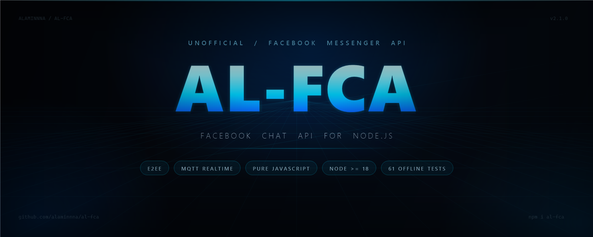
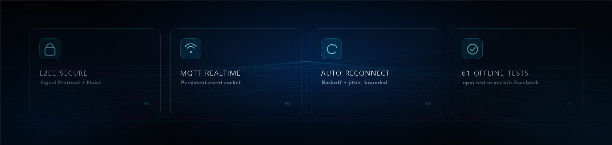
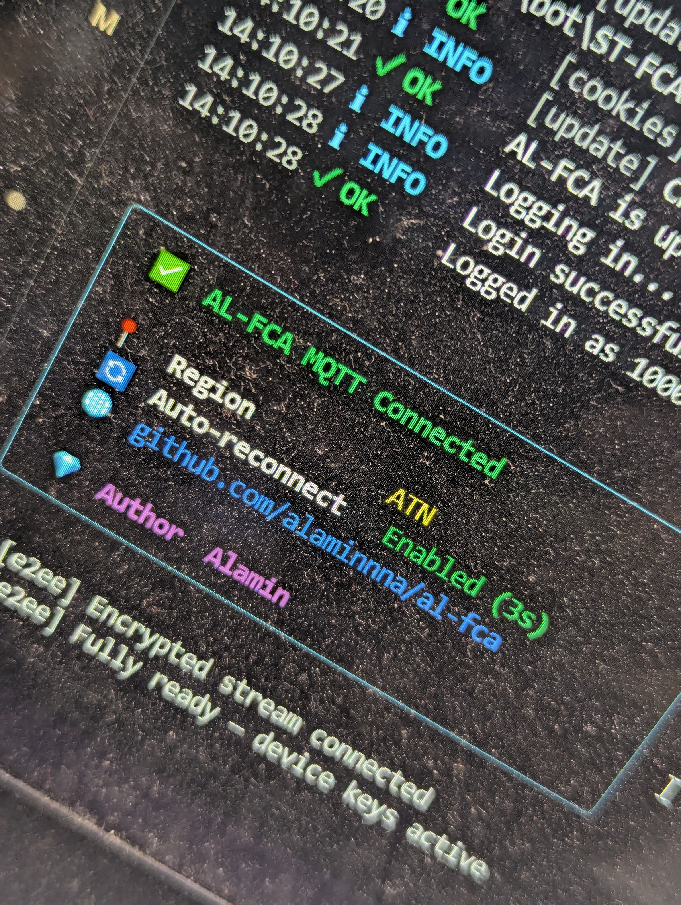
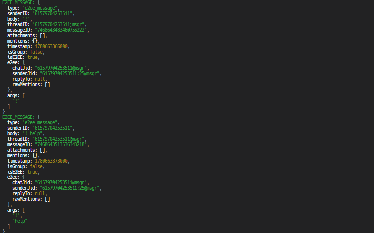

<div align="center">




<br/>

[](https://www.npmjs.com/package/al-fca)
[](https://www.npmjs.com/package/al-fca)
[](./LICENSE)
[](https://nodejs.org/)
[](#-e2ee--end-to-end-encryption)

**Interact with Facebook Messenger programmatically — built for bot developers.**

🔐 End-to-End Encryption · ⚡ MQTT realtime · 🧩 Pure JavaScript · 🛡️ Zero native binaries

[**Install**](#-installation) · [**Quick Start**](#-basic-usage) · [**E2EE Guide**](docs/E2EE_GUIDE.md) · [**npm**](https://www.npmjs.com/package/al-fca) · [**Issues**](https://github.com/alaminnna/al-fca/issues)

</div>

---

<table align="center">
<tr>
<td align="center" width="25%">
<h3>🔐 E2EE</h3>
<sub>Signal Protocol + Noise<br/>encrypted by default</sub>
</td>
<td align="center" width="25%">
<h3>⚡ MQTT</h3>
<sub>Realtime events over a<br/>persistent socket</sub>
</td>
<td align="center" width="25%">
<h3>🧩 Pure JS</h3>
<sub>No native build step,<br/>no compiled binaries</sub>
</td>
<td align="center" width="25%">
<h3>🧪 61 Tests</h3>
<sub>Fully offline suite,<br/><code>npm audit</code>: 0</sub>
</td>
</tr>
</table>

> I maintain this to keep Messenger bot building simple in Node.js. Small win by small win — auto-update, clearer logs, and encrypted chats when you need them. — **Al A Min**

**AL-FCA (`al-fca`)** is an unofficial Facebook Chat API for Node.js with auto-update checks and E2EE support. It emulates a browser session to automate chat on a user account.

<sub>**Keywords:** facebook chat api nodejs · messenger bot api · unofficial facebook messenger api · mqtt chatbot · al-fca e2ee · signal protocol messenger nodejs · alaminnna</sub>

<details>
<summary><b>📑 Table of Contents</b> — click to expand</summary>

<br/>

- [✨ What's New](#-whats-new-in-al-fca)
- [📦 Installation](#-installation)
- [🔄 Update Notifications](#-update-notifications-opt-in)
- [⚠️ Important Disclaimer](#️-important-disclaimer)
- [🔍 Introduction](#-introduction)
- [🚀 Basic Usage](#-basic-usage)
- [🔐 E2EE Encryption](#-e2ee--end-to-end-encryption)
- [📝 Message Types](#-message-types)
- [💾 AppState](#-saving-appstate-to-avoid-re-login)
- [👂 Listening](#-listening-for-messages)
- [📋 Logging](#-logging)
- [🎯 Quick Reference](#-quick-reference)
- [🙏 Credits](#-credits)
- [👨‍💻 Author — Al A Min (Alaminnna)](#-author--al-a-min-alaminnna)

</details>

<div align="center">

</div>

## ✨ What's New in AL-FCA

<sub>**2.1.0 — quality & security overhaul**</sub>

| | Change |
| :-- | :-- |
| 🔒 | **Security rewrite** — the auto-update system that ran `npm install` and restarted your bot without asking is gone. Update checks are notify-only and opt-in, no hardcoded upload keys, `getUID` no longer sends profile links to third-party resolvers, and `npm audit` reports **0 vulnerabilities** (the deprecated `request` stack was replaced). |
| ♻️ | **Lifecycle engineering** — bounded reconnect with exponential backoff + jitter, always-resolving `stopListening`, bounded E2EE caches, media-server shutdown. Long-running bots no longer leak memory. |
| 🐛 | **Crash-proof delta parsing** — malformed Messenger payloads emit `parse_error` events instead of killing the process; duplicate-send on ack timeout is fixed. |
| ⚡ | **Performance** — `makeDefaults` runs once per login (was ~120×), single config loader, **468k deltas/s** parsing throughput. |
| 🧪 | **61 offline tests** — fake MQTT broker, transport integration, crash regressions. `npm test` never touches Facebook. |
| 📚 | **New docs** — [AUDIT.md](AUDIT.md) · [API_COMPATIBILITY.md](API_COMPATIBILITY.md) · [ARCHITECTURE.md](ARCHITECTURE.md) · [SECURITY.md](SECURITY.md) · [TESTING.md](TESTING.md) · [TROUBLESHOOTING.md](TROUBLESHOOTING.md) · [INTEGRATION_TESTING.md](INTEGRATION_TESTING.md) |
| 🔐 | **E2EE** — Signal Protocol + Noise in pure JavaScript, with bounded correlation maps, capped media cache and shutdown hooks. |

<div align="center">

</div>

## 📦 Installation

```bash
npm install al-fca
```

> **Requirement:** Node.js **>= 18** (enforced via `engines`). For reproducible installs, commit `package-lock.json` and use `npm ci`.

<details>
<summary><b>Using another package manager?</b></summary>

<br/>

```bash
# yarn
yarn add al-fca

# pnpm
pnpm add al-fca

# bun
bun add al-fca
```

</details>

## 🔄 Update Notifications _(opt-in)_

AL-FCA **never installs packages, never rewrites your `package.json`, and never restarts your process.** Versions before 2.1.0 did exactly that — see [SECURITY.md](SECURITY.md).

To be notified when a newer version exists, opt in once:

```javascript
login({ appState }, { autoUpdateCheck: true /* ... */ });
```

That performs a single read-only GET to the npm registry per process and logs:

```text
AL-FCA <latest> is available (installed: <current>).
To update, run: npm install al-fca@latest
```

You decide when — or whether — to update.

```bash
# Manual update
npm install al-fca@latest
```

Programmatic check (no side effects beyond the registry GET):

```javascript
const { checkForFCAUpdate } = require("al-fca/checkUpdate.js");
const { updateAvailable, latest, current } = await checkForFCAUpdate();
```

## ⚠️ Important Disclaimer

> **We are not responsible if your account gets banned for spammy activity**, such as:
>
> - Sending lots of messages to people you don't know
> - Sending messages very quickly
> - Sending spammy-looking URLs
> - Logging in and out very quickly

**Recommendation:** Use the Firefox browser or [this website](https://fca.dongdev.id.vn) to reduce logout issues, especially for iOS users.

**Support:** If you encounter errors, contact us [here](https://www.facebook.com/mdong.dev).

## 🔍 Introduction

Facebook now has an [official API for chat bots](https://developers.facebook.com/docs/messenger-platform), however it's only available for Facebook Pages.

`al-fca` lets you automate chat on a **user account** by emulating the browser. This means:

| | |
| :-- | :-- |
| ✅ | Makes the exact same GET/POST requests as a browser |
| 🚫 | Does **not** work with auth tokens |
| 🔑 | Requires Facebook account credentials (email/password) or AppState |

## 🚀 Basic Usage

### 1 · Login and echo bot

```javascript
const login = require("al-fca");

login({ appState: [] }, (err, api) => {
    if (err) return console.error(err);

    api.listenMqtt((err, event) => {
        if (err) return console.error(err);

        // Echo back the received message
        api.sendMessage(event.body, event.threadID);
    });
});
```

### 2 · Send a text message

```javascript
const login = require("al-fca");

login({ appState: [] }, (err, api) => {
    if (err) {
        console.error("Login Error:", err);
        return;
    }

    const yourID = "000000000000000"; // Replace with the actual Facebook ID
    const msg = "Hey!";

    api.sendMessage(msg, yourID, (err) => {
        if (err) console.error("Message Sending Error:", err);
        else console.log("Message sent successfully!");
    });
});
```

> 💡 **Tip:** Find your Facebook ID inside the cookies under the name `c_user`.

### 3 · Send a file or image

```javascript
const login = require("al-fca");
const fs = require("fs");

login({ appState: [] }, (err, api) => {
    if (err) {
        console.error("Login Error:", err);
        return;
    }

    const yourID = "000000000000000";
    const imagePath = __dirname + "/image.jpg";

    // Check if the file exists
    if (!fs.existsSync(imagePath)) {
        console.error("Error: Image file not found!");
        return;
    }

    const msg = {
        body: "Hey!",
        attachment: fs.createReadStream(imagePath)
    };

    api.sendMessage(msg, yourID, (err) => {
        if (err) console.error("Message Sending Error:", err);
        else console.log("Message sent successfully!");
    });
});
```

<div align="center">

</div>

## 🔐 E2EE — End-to-End Encryption

AL-FCA includes **End-to-End Encryption support** for secure encrypted messaging, powered by [FB-Messenger-E2EE](https://github.com/HerokeyVN/FB-Messenger-E2EE) — Signal Protocol + Noise transport, pure JavaScript, no native binary required.

> 🗝️ Device keys persist at `.al-fca-e2ee/device.json` (created on first E2EE connect). Keep that file to stay the same registered E2EE device across restarts.

### What is E2EE?

E2EE ensures messages are encrypted on the sender's device and only decrypted on the recipient's device. No one in between — including servers — can read your messages.

### Features

<table>
<tr>
<td width="50%" valign="top">

- ✅ **Encrypted messages** — everything is encrypted
- ✅ **Encrypted attachments** — photos, videos, files
- ✅ **Automatic detection** — routes between E2EE and standard
- ✅ **Message reactions** — react to encrypted messages

</td>
<td width="50%" valign="top">

- ✅ **Message editing** — edit encrypted messages
- ✅ **Typing indicators** — over the E2EE channel
- ✅ **Device persistence** — reuse keys across sessions
- ✅ **Media server** — local cache for decrypted files

</td>
</tr>
</table>

### Quick Start

```javascript
const login = require("al-fca");
const fs = require("fs");

login(
    { appState: JSON.parse(fs.readFileSync("appstate.json", "utf8")) },
    {
        enableE2EE: true, // 🔐 Enable E2EE
        listenEvents: true,
        autoMarkRead: true
    },
    (err, api) => {
        if (err) return console.error(err);

        // Connect the E2EE bridge
        api.connectE2EE((err) => {
            if (err) console.error("E2EE connection failed:", err);
            else console.log("✓ E2EE connected!");
        });

        // Load device data
        api.getE2EEDeviceData((err) => {
            if (!err) console.log("✓ Device data loaded");
        });

        // Listen for E2EE messages
        api.listenMqtt((err, event) => {
            if (err) return console.error(err);

            if (event.type === "e2ee_message") {
                console.log("🔐 E2EE Message:", event.body);
                console.log("   Thread:", event.threadID);
                console.log("   Encrypted: ✓ YES");

                // Auto-reply with E2EE
                api.sendMessage("Received: " + event.body, event.threadID);
            }

            if (event.type === "e2ee_message_reaction") {
                console.log("🔐 E2EE Reaction:", event.reaction);
            }

            if (event.type === "e2ee_message_edit") {
                console.log("🔐 E2EE Message Edited:", event.body);
            }
        });
    }
);
```

### Event types

<details>
<summary><b>💬 E2EE message event</b></summary>

```javascript
event.type === "e2ee_message";
{
    type: "e2ee_message",
    senderID: "61568577897207",
    threadID: "61568577897207:69@msgr", // E2EE JID format
    body: "Hello encrypted world!",
    messageID: "m_1234567890",
    isE2EE: true, // 🔐 marked as encrypted
    isGroup: false,
    timestamp: 1780805668000,
    attachments: [],
    mentions: {}
}
```

</details>

<details>
<summary><b>❤️ E2EE reaction event</b></summary>

```javascript
event.type === "e2ee_message_reaction";
{
    type: "e2ee_message_reaction",
    messageID: "m_1234567890",
    reaction: "❤️",
    userID: "61568577897207",
    threadID: "61568577897207:69@msgr",
    isE2EE: true
}
```

</details>

<details>
<summary><b>✏️ E2EE message edit event</b></summary>

```javascript
event.type === "e2ee_message_edit";
{
    type: "e2ee_message_edit",
    messageID: "m_1234567890",
    body: "Updated encrypted message",
    senderID: "61568577897207",
    isE2EE: true
}
```

</details>

### API methods

```javascript
api.setOptions({ enableE2EE: true });            // enable E2EE in options
api.connectE2EE(callback);                       // connect the E2EE bridge
api.getE2EEDeviceData(callback);                 // get device encryption keys

api.sendMessage(message, e2eeThreadID, callback); // send (auto-detected)
api.setMessageReaction(emoji, messageID, callback); // react
api.editMessage(message, messageID, callback);      // edit
api.unsendMessage(messageID, callback);             // unsend

api.sendTypingE2EE(threadID, callback);          // typing indicator
api.downloadE2EEMedia(messageID, callback);      // download media
api.resolveE2EEAttachment(attachment);           // resolve attachment URL
```

### Connection flow

<div align="center">

</div>

*Successful E2EE bridge connection showing: login with cookies → MQTT established → E2EE bridge connected → device keys established.*

### Message listening

<div align="center">

</div>

*E2EE message event showing: encrypted message received, JID format, sender/thread info, and the `isE2EE: true` flag.*

### Configuration

```json
{
    "e2ee": {
        "enable": true,
        "devicePath": "./.al-fca-e2ee/device.json"
    },
    "enableTypingIndicator": true,
    "typingDuration": 4000
}
```

Or directly in login options:

```javascript
{
    enableE2EE: true,
    e2eeDevicePath: "./.al-fca-e2ee/device.json",
    e2eeMediaCdnHost: "https://mmeg.facebook.com", // for E2EE media downloads
    autoReconnect: true,
    listenEvents: true
}
```

### Test bot

An E2EE test bot ships with the published package (local-only, not in this git repo):

```bash
# Inside the installed package
node node_modules/al-fca/e2eebot.js
```

| Command | Action |
| :-- | :-- |
| `!ping` | Test bot response |
| `!info` | Show message info |
| `!echo <text>` | Echo message |
| `!react` | React with ❤️ |
| `!help` | Show help |

### Full documentation

See [E2EE_GUIDE.md](docs/E2EE_GUIDE.md) for architecture, API methods, event types, attachment handling, device data management and troubleshooting.

<div align="center">

</div>

## 📝 Message Types

| Type | Usage |
| :-- | :-- |
| **Regular text** | `{ body: "message text" }` |
| **Sticker** | `{ sticker: "sticker_id" }` |
| **File / Image** | `{ attachment: fs.createReadStream(path) }` or an array of streams |
| **URL** | `{ url: "https://example.com" }` |
| **Large emoji** | `{ emoji: "👍", emojiSize: "large" }` — `small` / `medium` / `large` |

> **Note:** A message can only be a regular message (which may be empty) plus optionally **one of**: a sticker, an attachment, or a URL.

## 💾 Saving AppState to Avoid Re-login

### Save AppState

```javascript
const fs = require("fs");
const login = require("al-fca");

login({ appState: [] }, (err, api) => {
    if (err) {
        console.error("Login Error:", err);
        return;
    }

    try {
        const appState = JSON.stringify(api.getAppState(), null, 2);
        fs.writeFileSync("appstate.json", appState);
        console.log("✅ AppState saved successfully!");
    } catch (error) {
        console.error("Error saving AppState:", error);
    }
});
```

### Use saved AppState

```javascript
const fs = require("fs");
const login = require("al-fca");

login(
    { appState: JSON.parse(fs.readFileSync("appstate.json", "utf8")) },
    (err, api) => {
        if (err) {
            console.error("Login Error:", err);
            return;
        }

        console.log("✅ Logged in successfully!");
        // Your code here
    }
);
```

> **Alternative:** use [c3c-fbstate](https://github.com/c3cbot/c3c-fbstate) to generate `fbstate.json`.

## 👂 Listening for Messages

### Echo bot with a stop command

```javascript
const fs = require("fs");
const login = require("al-fca");

login(
    { appState: JSON.parse(fs.readFileSync("appstate.json", "utf8")) },
    (err, api) => {
        if (err) {
            console.error("Login Error:", err);
            return;
        }

        // Receive events (join/leave, title change, …)
        api.setOptions({ listenEvents: true });

        const stopListening = api.listenMqtt((err, event) => {
            if (err) {
                console.error("Listen Error:", err);
                return;
            }

            api.markAsRead(event.threadID, (err) => {
                if (err) console.error("Mark as read error:", err);
            });

            switch (event.type) {
                case "message":
                    if (event.body && event.body.trim().toLowerCase() === "/stop") {
                        api.sendMessage("Goodbye…", event.threadID);
                        stopListening();
                        return;
                    }
                    api.sendMessage(`TEST BOT: ${event.body}`, event.threadID);
                    break;

                case "event":
                    console.log("Event Received:", event);
                    break;
            }
        });
    }
);
```

### Listen options

```javascript
api.setOptions({
    listenEvents: true, // receive events (join/leave, rename, …)
    selfListen: true,   // receive messages from yourself
    logLevel: "silent"  // silent / error / warn / info / verbose
});
```

**Defaults:**

| Option | Default | Effect |
| :-- | :-- | :-- |
| `listenEvents` | `false` | Won't receive join/leave, title changes |
| `selfListen` | `false` | Ignores messages sent by the current account |

## 📋 Logging

All boot, update, MQTT and E2EE status lines go through one styled logger:

```text
08:14:02 ✔ OK     AL-FCA is up to date (v2.1.0)
08:14:03 ℹ INFO   Logging in...
08:14:05 ⚠ WARN   [setOptions] Unrecognized option given to setOptions: foo
08:14:06 ✖ ERROR  MQTT send failed, falling back to HTTP
08:14:09 · DEBUG  [parseAndCheckLogin] {"req":1}
```

Control the level with the `AL_FCA_LOG_LEVEL` env var or at runtime:

```javascript
api.setOptions({
    logLevel: "silent" // silent / error / warn / success / info / verbose / debug / silly
});
```

```bash
AL_FCA_LOG_LEVEL=debug node index.js
```

## 🛠️ Projects Using This API

### Primary project

- **[AL-FCA](https://github.com/alaminnna/AL-FCA)** — an enhanced version of GoatBot V2: a powerful, customizable Facebook Messenger bot with advanced features, plugin support and automatic updates. This is the main project AL-FCA was designed for.

### Other use cases

AL-FCA works for any Facebook Messenger bot or automation project. Build your own messenger bot, or integrate the API wherever you need it.

## 📚 Full API Documentation

- **Quick Reference** below covers the most common methods with examples
- **E2EE**: see [E2EE_GUIDE.md](docs/E2EE_GUIDE.md) for architecture, API methods, event types and troubleshooting
- **Login options**: `online`, `selfListen`, `listenEvents`, `updatePresence`, `forceLogin`, `autoMarkDelivery`, `autoMarkRead`, `listenTyping`, `autoReconnect`, `emitReady`, `enableE2EE`, `logLevel`, `e2eeDevicePath`, `e2eeMediaCdnHost`
- Every module in `src/` maps to one `api.<name>` method (see [index.js](./index.js))

## 🎯 Quick Reference

```javascript
api.sendMessage(message, threadID, callback);          // send a message
api.sendTypingIndicator(threadID, callback);           // typing indicator
api.markAsRead(threadID, callback);                    // mark as read

api.getUserInfo(userID, callback);                     // user info
api.getThreadInfo(threadID, callback);                 // thread info

api.changeThreadColor(color, threadID, callback);      // thread color
api.changeThreadEmoji(emoji, threadID, callback);      // thread emoji
api.setMessageReaction(reaction, messageID, callback); // message reaction
```

## 🙏 Credits

I built this on top of others' open-source work:

- **[ST-FCA](https://github.com/sheikhtamimlover/ST-FCA)** — the original repo this project is based on.
- **[FB-Messenger-E2EE](https://github.com/HerokeyVN/FB-Messenger-E2EE)** — the library behind the E2EE support here (Signal Protocol + Noise, pure JavaScript).

Thanks to both maintainers for sharing their work openly.

## 🤝 Contributing

Contributions are welcome!

```bash
# 1. Fork the repository, then:
git checkout -b feature/AmazingFeature
git commit -m "Add some AmazingFeature"
git push origin feature/AmazingFeature
```

Then open a Pull Request. 🚀

## 📄 License

**MIT License** — see [LICENSE](./LICENSE) for details.

<div align="center">

</div>

## 👨‍💻 Author — Al A Min (Alaminnna)

<div align="center">


### Al A Min — **Alaminnna**

*AI Developer · Full Stack Web Developer · Student · Entrepreneur · Open Source Builder*

📍 Dhaka, Bangladesh · 🌐 [alaminnna.ami.bd](https://alaminnna.ami.bd)


<br/><br/>

[](https://github.com/alaminnna)
[](https://www.linkedin.com/in/alaminnna/)
[](https://www.npmjs.com/~alaminnna)
[](https://medium.com/@Alaminnna)
[](https://dev.to/alaminnna)
[](https://www.youtube.com/@alaminnna)
[](https://www.instagram.com/alaminnna)
[](https://www.threads.net/@alaminnna)
[](https://www.tiktok.com/@alaminnnna)
[](https://www.pinterest.com/alaminnnnna/)
[](https://stackoverflow.com/users/33006113/alaminnna)
[](https://hashnode.com/@alaminnna)
[](https://www.producthunt.com/@alaminnna)
[](https://linktr.ee/alaminnna)
[](https://www.facebook.com/profile.php?id=61592578435860)

</div>

## ⭐ Support

If this project helps you, please give it a ⭐ on GitHub — it helps others find it.

<div align="center">

[](https://github.com/alaminnna/al-fca/stargazers)

</div>

## 🔗 Links

| Resource | Link |
| :-- | :-- |
| 📦 NPM Package | [npmjs.com/package/al-fca](https://www.npmjs.com/package/al-fca) |
| 🐙 GitHub Repository | [github.com/alaminnna/al-fca](https://github.com/alaminnna/al-fca) |
| 🐛 Issue Tracker | [github.com/alaminnna/al-fca/issues](https://github.com/alaminnna/al-fca/issues) |
| 🔐 E2EE Guide | [docs/E2EE_GUIDE.md](docs/E2EE_GUIDE.md) |

---

<div align="center">


*Built by **Al A Min (Alaminnna)** in Dhaka, Bangladesh. Next version already in progress.*

</div>

**Disclaimer:** This is an unofficial API and is not officially supported by Facebook. Use responsibly and comply with the [Facebook Terms of Service](https://www.facebook.com/terms.php).
